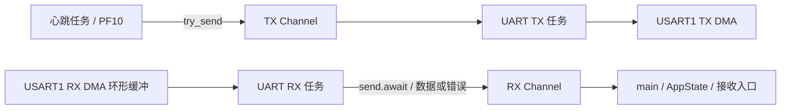

# Embassy 迁移：第二步（独立任务与消息通道）

已把心跳、串口发送、串口接收拆成独立的 Embassy 任务。
每秒翻转 PF10，并通过 USART1 输出 `tick <毫秒>ms`；接收与心跳可同时等待。
PID 算法暂时只初始化，尚未接入 PWM、编码器或闭环控制。

## 分层

- `main.rs`：`#[embassy_executor::main]` 创建 Cortex-M 线程模式执行器，运行 App。
- `runtime/board.rs`：初始化 STM32F407ZG、时钟、引脚、DMA 和中断绑定。
- `runtime/app.rs`：组装两条静态 Channel，启动三个任务；main 消费 RX 事件、持有业务状态。
- `runtime/tasks.rs`：心跳、UART TX、UART RX 三个独立任务，只持有各自需要的句柄。
- `drivers/uart.rs`：封装 DMA 收发，`split()` 交出独占的 `UartSender` / `UartReceiver`；
  各方向共用只含原子计数器的 `UartCounters`，不锁住整个串口。
- `control/pid.rs`：纯算法，不依赖 HAL，后续控制任务继续复用。
- `comm/proto.rs`：零硬件依赖的接收入口，记录字节数、数据块数、错误事件数和最近数据。
  目前不解析命令、不回显，不把一次 DMA read 的结果当作完整协议帧。
- `runtime/panic.rs`：禁用中断后停止 USART1 TX DMA，直接用 PAC 输出错误并闪 PF9。
  此处保留 DWT 忙等，不依赖已停止工作的异步调度。

当前共四个任务：main 应用任务、心跳任务、串口 TX 任务、串口 RX 任务。
PID 状态只由 main 持有，尚未启动控制任务。

TX Channel 容量 8 条，每条最多 128 字节；RX Channel 容量 4 个事件，
每个数据事件最多 64 字节。配置集中在 `runtime/config.rs`，均为固定容量，无堆分配。
队列参数传给任务，硬件句柄不通过共享 Mutex 在任务间轮流借用。

心跳通过 `try_send` 提交日志：拥塞时整条丢弃并增加 `heartbeat_log_dropped()`，
不等待串口，因此不会因 TX 队列满而拖慢闪灯。其他可靠发送方可用 Sender 的
`send(message).await` 等待空间，但入队成功只代表交给 TX 任务，不代表线上发送完成。
TX 任务只按队列顺序发出消息，UART 硬件错误计数后继续下一条，不自动重发。

RX 任务持续读取 DMA 环形缓冲，通过 `send(event).await` 保序交给 main。
RX Channel 满时暂停消费 DMA 环形缓冲；若应用长时间不处理仍可能发生 overrun。
因此应用的接收处理应快速返回，耗时处理以后另拆任务。
RX 出错时先交付错误事件，再让出一次执行机会，下一次 read 自动重启接收。
main 记录错误并清除最近数据，后续解析器应在该入口丢弃未完成帧并重新同步。
`drivers/dwt.rs`、`runtime/sched.rs` 和 `comm/ringbuf.rs` 暂留工具代码，
当前运行路径不使用它们；DWT 工具必须显式初始化后才能调用。

## 硬件资源

| 用途 | 资源 | 配置 |
| --- | --- | --- |
| 系统时钟 | HSE + PLL | 外部晶振 8 MHz，HCLK 168 MHz |
| 总线 | APB1 / APB2 | 42 MHz / 84 MHz |
| Embassy 时基 | TIM9 | `time-driver-tim9`，逻辑 tick 32,768 Hz |
| 时间驱动中断 | TIM1_BRK_TIM9 | 与 TIM1 break 共用向量，后续如需 break 须统一处理中断 |
| 心跳 LED | PF10 | 保持原程序初始低电平，每秒翻转 |
| Panic LED | PF9 | 保持原程序初始低电平，panic 时闪烁 |
| USART1 | PA9 TX / PA10 RX | 115200、8N1 |
| USART1 TX DMA | DMA2 stream 7、channel 4 | Embassy 句柄名 `DMA2_CH7` |
| USART1 RX DMA | DMA2 stream 2、channel 4 | Embassy 句柄名 `DMA2_CH2`，256 字节环形缓冲 |

Embassy 的 `DMA2_CHx` 在 F4 对应 DMA stream，外设请求 channel 由 HAL 选择。
DMA 缓冲和发送数据必须在 DMA 可访问的 SRAM；当前链接脚本 RAM 位于
`0x20000000`，保留 128 KiB，未使用不能被 DMA 访问的 CCM。

TIM9 供所有 `Timer`、`Ticker` 和 `Instant` 共用，不给每个异步任务单独分配定时器。
它不占 GPIO 引脚，但整个 TIM9 不能再用于 PWM 等功能。
预留 TIM1/TIM8 作电机 PWM，TIM2/TIM5 作编码器；具体分配待电机引脚确定。

SysTick 原理上可以做 Embassy 时基，但 `embassy-stm32 0.6` 无内置 SysTick
时间驱动。若要采用，需自行实现 `embassy-time-driver` 的计时、唤醒和中断逻辑。
当前采用官方 TIM 驱动。32,768 Hz 是软件时间单位，实际精度还受晶振及定时器分频影响；
以后需要微秒级控制采样时，再根据控制周期调整 tick 和中断优先级。

## UART 驱动接口

- `UartLink::split()` 将 TX/RX 分给两个任务，原 `UartLink` 被消耗。
- `UartSender::send(data).await` / `send_str(text).await`：借用数据直到 DMA 发送完成，等待时让出执行器。
  不再复制到软件发送队列，也不再返回 `QueueFull`。大于 65,535 字节时分段发送。
- `flush().await`：进一步等待最后一个字节在线上发完。
- `read(buf).await` / `read_byte().await`：等数据到达再返回。
  RX 在初始化时开始后台接收，由 RX 任务持续消费。
- 格式化先写入 `heapless::String`，再异步发送；不再对 UART 实现同步 `fmt::Write`。
- `stats()` 统计 HAL 向读取/发送调用报告的错误事件。溢出不等同于精确丢字节数，
  因此移除旧 `rx_dropped`、`tx_queue_full`。错误后下一次读取会自动重启 RX。
- DMA 发送被取消时可能已发出部分数据；取消不能保证消息整条撤回。
- 旧 UART5 工厂没有在当前板级初始化中使用，已随旧 HAL 中断实现一起替换。
  以后增加 UART5 时，在 board 分配引脚、DMA、独立静态 `UartCounters`，再复用 `UartLink::new`。

心跳时间从 Embassy 时基初始化起算。`Ticker` 按固定时间轴调度，与旧
`PeriodicTask` 按实际执行时刻重新计时不同；未来 PID 的 dt 应使用真实的采样间隔。

## 验证和下一步

已通过开发版和 release 版交叉编译、链接，以及修改文件的 rustfmt 检查。
ELF 符号确认 TIM1_BRK_TIM9、USART1 和 DMA2 stream 2/7 已绑定处理函数，
SysTick 仍指向默认处理函数，未作为时基使用。尚未烧写或进行硬件验证。
上板时执行 `cargo run --release`，串口设置 115200、8N1，观察每秒 `tick` 和 PF10 翻转。
应观察时间戳持续递增，并持续运行超过旧 DWT 的约 25.6 秒回绕周期。
接收任务和 main 消费者已接通，数据块记录在应用的 `RxState` 中，不做回显；
可在调试构建中观察 `state.rx`（优化可能影响变量可见性）。
上板需同时发送短数据和超过 256 字节的连续数据，验证心跳继续运行且接收统计更新。
溢出和错误恢复仍需硬件注入验证。

下一步确定串口协议帧格式和命令，在 `comm/proto.rs` 接入增量解析；
回应消息可由 main 提交到同一 TX Channel。之后接入编码器/PWM 和控制任务，
根据控制周期决定是否使用中断执行器或硬件定时器触发采样。

控制任务不得依赖日志发送速度，也不能在普通异步任务里长时间忙等。
Embassy 提供任务调度，具体实时性仍需在硬件上测量和验证。
